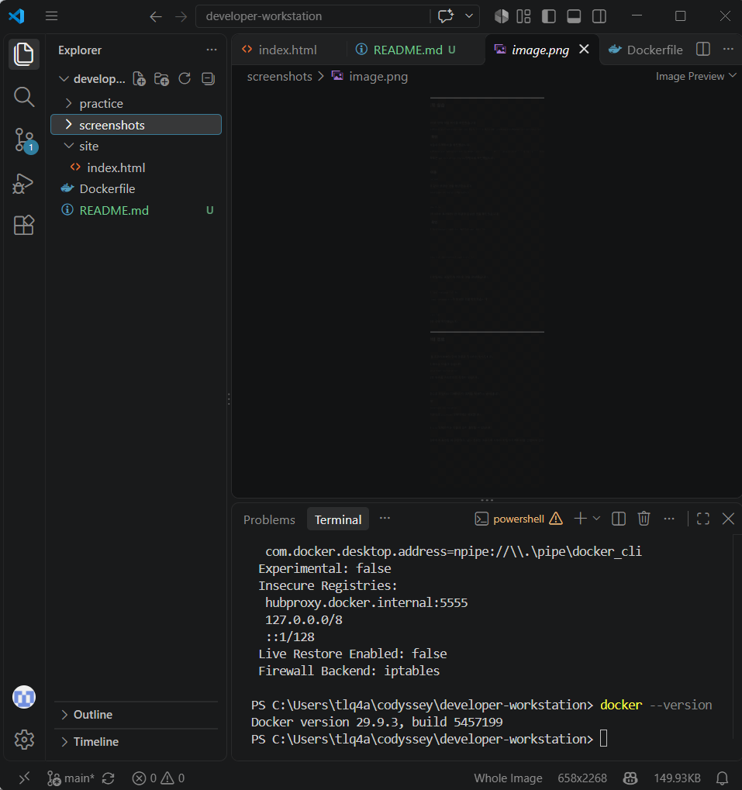
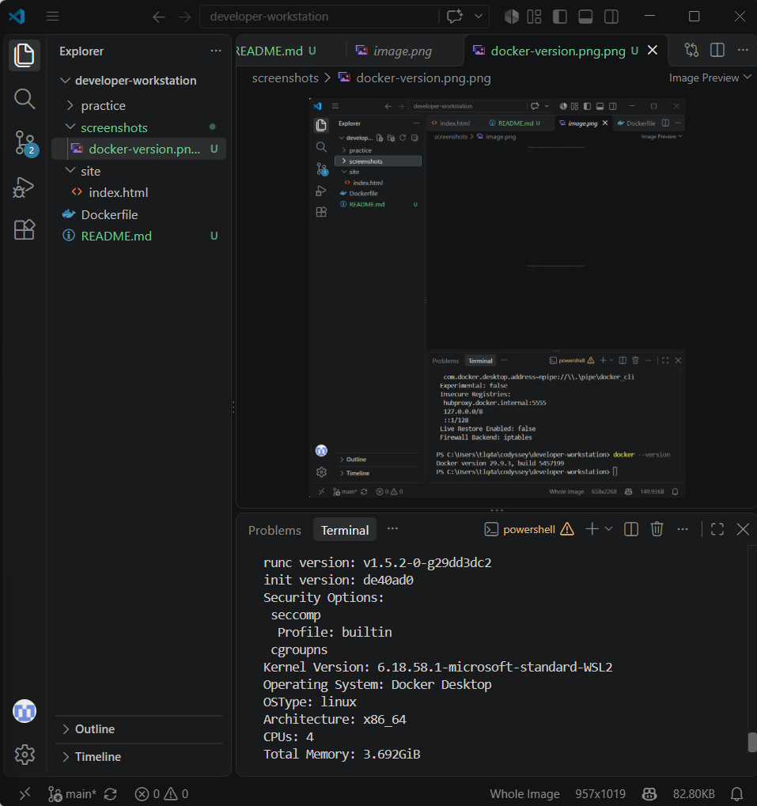
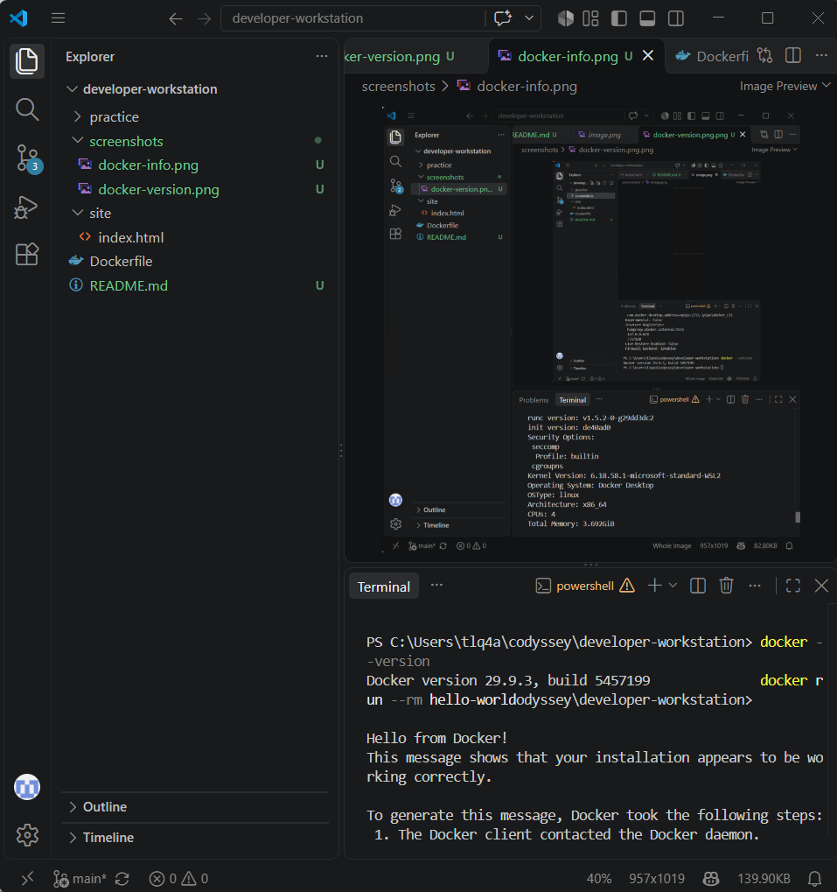
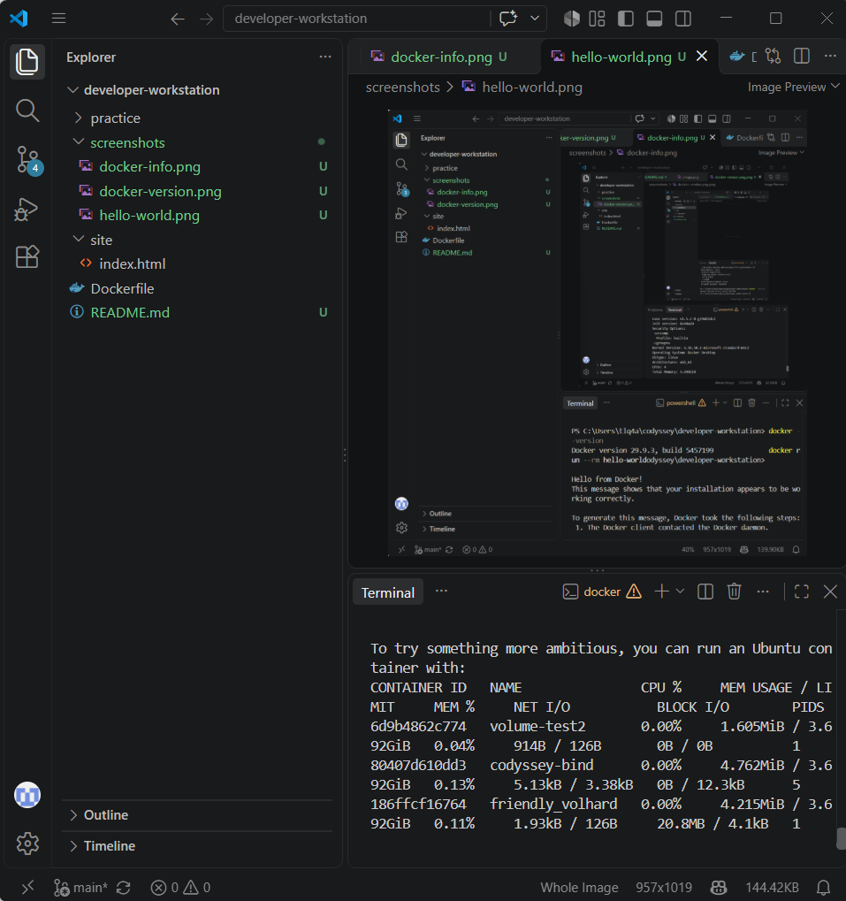
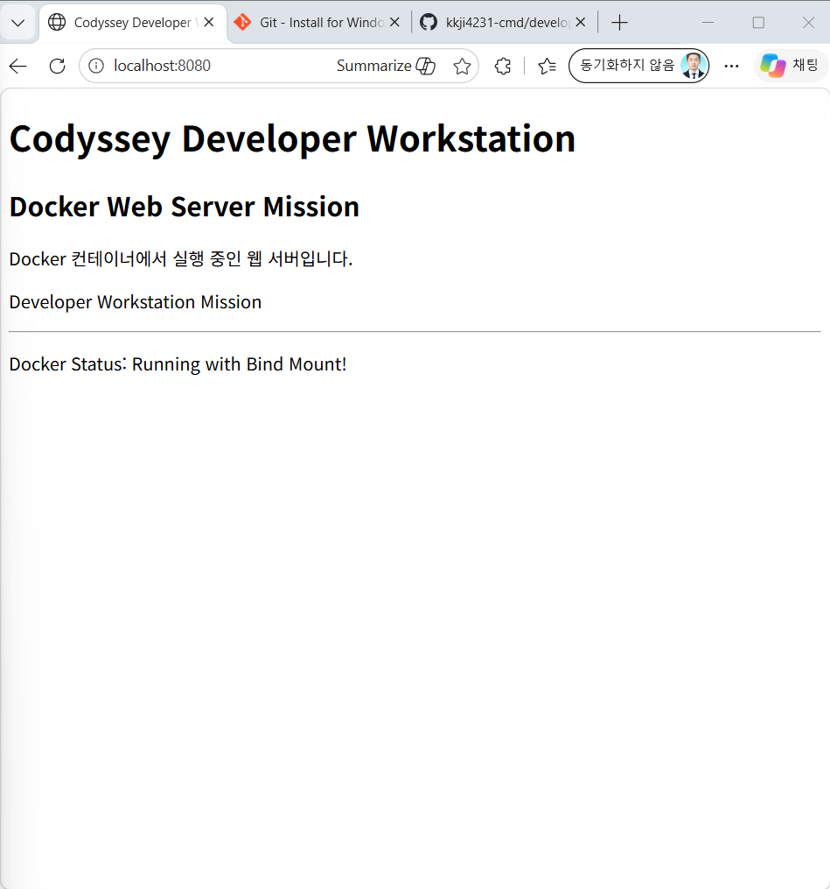
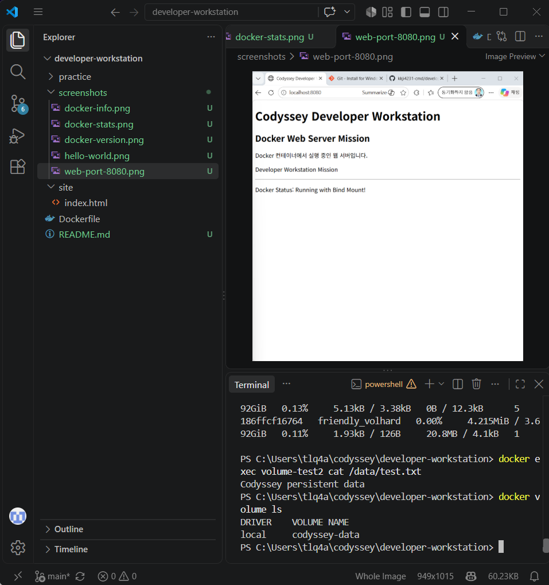
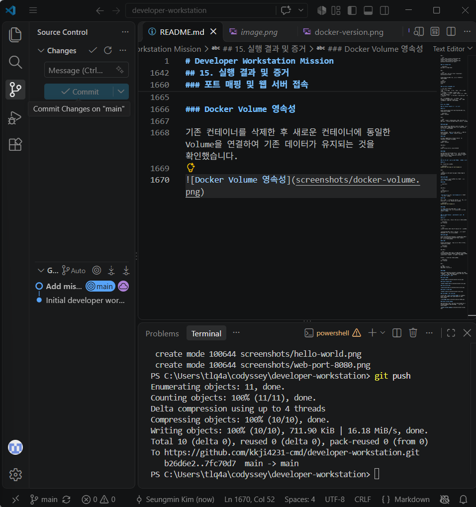

# Developer Workstation Mission

## 1. 프로젝트 개요

이 프로젝트는 개발 워크스테이션을 직접 구축하면서 터미널, Linux 파일 권한, Docker, Git, GitHub의 기본 개념과 사용 방법을 학습하기 위한 프로젝트입니다.

Windows 환경에서 VS Code와 PowerShell을 사용하여 기본적인 CLI 명령을 실습하고, WSL2 기반 Docker Desktop 환경을 구축했습니다.

이후 Ubuntu 컨테이너에서 Linux 파일 권한을 실습하고, NGINX 기반 커스텀 Docker 이미지를 제작하여 웹 서버를 실행했습니다.

또한 포트 매핑, Bind Mount, Docker Volume을 직접 구성하고 동작을 검증했으며, 최종 프로젝트 파일을 Git으로 버전 관리하여 GitHub Repository와 연동했습니다.

---

## 2. 실행 환경

| 구분 | 환경 |
|---|---|
| OS | Windows |
| 개발 도구 | Visual Studio Code |
| Terminal | PowerShell |
| WSL | WSL 3.0.5.0 |
| Linux Kernel | 6.18.58.1-1 |
| Docker | 29.9.3 |
| Docker Desktop | WSL2 Backend |
| Git | 2.56.1.windows.1 |
| Git 기본 브랜치 | main |

---

## 3. 프로젝트 구조

```text
developer-workstation/
├── Dockerfile
├── README.md
├── practice/
│   └── test.txt
└── site/
    └── index.html
```

---
## 4. 수행 체크리스트

### Terminal / CLI
- [x] 현재 위치 확인 (`pwd`)
- [x] 파일 및 디렉터리 목록 확인 (`ls`)
- [x] 숨김 항목 포함 목록 확인 (`Get-ChildItem -Force`)
- [x] 디렉터리 생성 및 이동
- [x] 빈 파일 생성
- [x] 파일 내용 작성 및 확인
- [x] 파일 복사
- [x] 파일 이름 변경
- [x] 파일 삭제

### Linux 권한
- [x] Ubuntu 컨테이너에서 Linux CLI 실행
- [x] 파일 권한 확인 (`ls -l`)
- [x] 파일 권한 644 → 755 변경
- [x] 디렉터리 권한 755 → 700 변경
- [x] r / w / x 권한 의미 확인

### Docker
- [x] WSL2 설치 및 확인
- [x] Docker Desktop 설치
- [x] `docker --version` 확인
- [x] `docker info` 확인
- [x] `hello-world` 실행
- [x] Ubuntu 컨테이너 실행
- [x] `docker images` 확인
- [x] `docker ps` / `docker ps -a` 확인
- [x] `docker logs` 확인
- [x] `docker stats` 확인

### Dockerfile / Web Server
- [x] NGINX 기반 Dockerfile 작성
- [x] 커스텀 이미지 `codyssey-web:1.0` 빌드
- [x] 컨테이너 실행
- [x] 포트 매핑 `8080:80`
- [x] `http://localhost:8080` 접속 확인

### Storage
- [x] Bind Mount 구성
- [x] 호스트 파일 변경 즉시 반영 확인
- [x] Docker Volume 생성
- [x] Volume에 데이터 저장
- [x] 기존 컨테이너 삭제
- [x] 새 컨테이너에서 기존 데이터 유지 확인

### Git / GitHub
- [x] Git 설치
- [x] Git 사용자 정보 설정
- [x] 기본 브랜치 `main` 설정
- [x] 로컬 Git Repository 생성
- [x] 최초 Commit 생성
- [x] GitHub Repository 생성
- [x] 원격 저장소 `origin` 연결
- [x] `main` 브랜치 Push
---

## 5. 터미널 기본 조작 로그

### 5.1 현재 위치 확인

```powershell
pwd
```

확인 결과:

```text
C:\Users\tlq4a\codyssey\developer-workstation
```

`pwd` 명령으로 현재 작업 중인 디렉터리의 절대 경로를 확인했습니다.

### 5.2 파일 및 디렉터리 목록 확인

```powershell
ls
```

프로젝트 폴더에서 `practice`, `site`, `Dockerfile`, `README.md` 등의 파일 및 디렉터리를 확인했습니다.

숨김 항목을 포함하여 확인할 때는 다음 명령을 사용했습니다.

```powershell
Get-ChildItem -Force
```

### 5.3 디렉터리 생성 및 이동

```powershell
mkdir practice
cd practice
pwd
```

이동 후 경로:

```text
C:\Users\tlq4a\codyssey\developer-workstation\practice
```

### 5.4 빈 파일 생성

```powershell
New-Item test.txt -ItemType File
```

확인:

```powershell
ls
```

생성 직후 `test.txt`의 Length가 `0`으로 표시되어 빈 파일이 정상적으로 생성된 것을 확인했습니다.

### 5.5 파일 내용 작성

```powershell
"Codyssey CLI Practice" | Set-Content test.txt
```

내용 확인:

```powershell
Get-Content test.txt
```

출력:

```text
Codyssey CLI Practice
```

### 5.6 파일 복사

```powershell
Copy-Item test.txt test-copy.txt
```

복사한 파일 내용 확인:

```powershell
Get-Content test-copy.txt
```

출력:

```text
Codyssey CLI Practice
```

### 5.7 파일 이름 변경

```powershell
Rename-Item test-copy.txt test-renamed.txt
```

파일 목록을 확인하여 `test-copy.txt`가 `test-renamed.txt`로 변경된 것을 확인했습니다.

### 5.8 파일 삭제

```powershell
Remove-Item test-renamed.txt
```

삭제 후:

```powershell
ls
```

최종적으로 다음 파일만 남은 것을 확인했습니다.

```text
test.txt
```

---

## 6. 절대 경로와 상대 경로

### 절대 경로

절대 경로는 파일 또는 디렉터리의 위치를 처음부터 전체 경로로 표현하는 방식입니다.

이번 프로젝트의 절대 경로:

```text
C:\Users\tlq4a\codyssey\developer-workstation
```

현재 작업 위치와 관계없이 동일한 위치를 명확하게 지정할 수 있습니다.

### 상대 경로

상대 경로는 현재 작업 위치를 기준으로 다른 파일이나 디렉터리의 위치를 표현합니다.

예를 들어 현재 위치가:

```text
C:\Users\tlq4a\codyssey\developer-workstation
```

일 때:

```powershell
cd practice
```

를 실행하면 다음 위치로 이동합니다.

```text
C:\Users\tlq4a\codyssey\developer-workstation\practice
```

또한 현재 위치 기준 `site` 폴더는 다음처럼 표현할 수 있습니다.

```text
.\site
```

따라서 절대 경로는 전체 위치를 명확하게 지정할 때 편리하고, 상대 경로는 프로젝트 내부의 파일이나 디렉터리를 간결하게 참조할 때 편리합니다.
---
---

## 7. Linux 파일 권한 실습

Windows PowerShell에서는 Linux의 `chmod` 권한 체계를 직접 실습하기 어렵기 때문에 Docker Ubuntu 컨테이너 내부에서 Linux 파일 및 디렉터리 권한을 실습했습니다.

### 7.1 Ubuntu 컨테이너 실행

```powershell
docker run -it ubuntu bash
```

Ubuntu 컨테이너 진입 후 다음과 같은 프롬프트가 표시되었습니다.

```text
root@186ffcf16764:/#
```

기본 Linux 명령도 실행했습니다.

```bash
pwd
ls
echo "Hello from Ubuntu Container"
```

출력:

```text
/
Hello from Ubuntu Container
```

---

### 7.2 파일 권한 실습 준비

실습용 디렉터리와 파일을 생성했습니다.

```bash
mkdir /permission-practice
cd /permission-practice
touch permission-test.txt
ls -l
```

초기 파일 권한:

```text
-rw-r--r-- 1 root root 0 Nov 14 14:41 permission-test.txt
```

`-rw-r--r--`는 숫자 권한으로 `644`입니다.

---

### 7.3 r / w / x 의미

Linux 권한은 다음 값을 사용합니다.

| 권한 | 의미 | 값 |
|---|---|---:|
| r | Read, 읽기 | 4 |
| w | Write, 쓰기 | 2 |
| x | Execute, 실행 | 1 |

권한은 다음 세 그룹으로 나뉩니다.

```text
소유자 / 그룹 / 기타 사용자
```

예를 들어:

```text
644
```

는 다음과 같이 해석됩니다.

```text
6 = 4 + 2 = rw-
4 = 4     = r--
4 = 4     = r--
```

따라서:

```text
644 = rw-r--r--
```

입니다.

---

### 7.4 파일 권한 644 → 755 변경

다음 명령으로 파일 권한을 변경했습니다.

```bash
chmod 755 permission-test.txt
ls -l
```

변경 결과:

```text
-rwxr-xr-x 1 root root 0 Nov 14 14:41 permission-test.txt
```

`755`는 다음과 같이 해석됩니다.

```text
7 = 4 + 2 + 1 = rwx
5 = 4 + 1     = r-x
5 = 4 + 1     = r-x
```

따라서:

```text
755 = rwxr-xr-x
```

파일 권한이 다음과 같이 변경된 것을 확인했습니다.

```text
변경 전 : -rw-r--r--  (644)
변경 후 : -rwxr-xr-x  (755)
```

---

### 7.5 디렉터리 권한 변경

실습용 디렉터리를 생성하고 초기 권한을 확인했습니다.

```bash
mkdir permission-dir
ls -ld permission-dir
```

초기 결과:

```text
drwxr-xr-x 2 root root 4096 Nov 14 14:43 permission-dir
```

초기 권한은 `755`입니다.

다음 명령으로 `700`으로 변경했습니다.

```bash
chmod 700 permission-dir
ls -ld permission-dir
```

변경 결과:

```text
drwx------ 2 root root 4096 Nov 14 14:43 permission-dir
```

따라서 디렉터리 권한이 다음과 같이 변경되었습니다.

```text
변경 전 : drwxr-xr-x  (755)
변경 후 : drwx------  (700)
```

`700`은 소유자만 읽기, 쓰기, 접근이 가능하고 그룹과 기타 사용자는 권한이 없는 설정입니다.

---

### 7.6 실습 결과 확인

Ubuntu 컨테이너를 종료한 후 다시 실행하고 `docker exec`로 접속했습니다.

```powershell
docker start friendly_volhard
docker exec -it friendly_volhard bash
```

다시 접속한 후:

```bash
ls -l /permission-practice
```

결과:

```text
drwx------ 2 root root 4096 Nov 14 14:43 permission-dir
-rwxr-xr-x 1 root root    0 Nov 14 14:41 permission-test.txt
```

동일한 컨테이너를 중지했다가 다시 실행해도 생성했던 파일과 설정한 권한이 그대로 유지되는 것을 확인했습니다.
---

---

## 8. Docker 설치 및 기본 운영

### 8.1 WSL2 설치 및 확인

Windows 환경에서 Docker Desktop의 Linux 컨테이너를 사용하기 위해 WSL을 설치했습니다.

```powershell
wsl --version
```

확인 결과:

```text
WSL 버전: 3.0.5.0
커널 버전: 6.18.58.1-1
```

---

### 8.2 Docker 버전 확인

Docker Desktop 설치 후 다음 명령으로 Docker CLI 설치 상태를 확인했습니다.

```powershell
docker --version
```

결과:

```text
Docker version 29.9.3, build 5457199
```

---

### 8.3 Docker Engine 동작 확인

```powershell
docker info
```

주요 확인 결과:

```text
Client:
 Version: 29.9.3
 Context: desktop-linux

Server:
 Containers: 0
 Images: 0
 Server Version: 29.9.3

Kernel Version: 6.18.58.1-microsoft-standard-WSL2
Operating System: Docker Desktop
OSType: linux
Architecture: x86_64
```

Client뿐 아니라 Server 정보까지 정상적으로 출력되어 Docker Engine이 정상 동작하는 것을 확인했습니다.

---

### 8.4 hello-world 컨테이너 실행

Docker 설치 상태를 실제 컨테이너 실행으로 검증했습니다.

```powershell
docker run hello-world
```

실행 결과:

```text
Hello from Docker!
This message shows that your installation appears to be working correctly.
```

이 과정에서 Docker가 다음 순서로 동작하는 것을 확인했습니다.

```text
Docker Client
↓
Docker Daemon
↓
Docker Hub에서 hello-world 이미지 다운로드
↓
Container 생성
↓
Container 실행
↓
결과 출력
```

---

### 8.5 Docker 이미지 확인

```powershell
docker images
```

확인된 이미지:

```text
hello-world:latest
ubuntu:latest
codyssey-web:1.0
```

Docker Image는 컨테이너를 생성하기 위한 실행 환경 및 파일 시스템의 템플릿이고, Container는 해당 이미지를 기반으로 실제 실행되는 인스턴스입니다.

---

### 8.6 실행 중 컨테이너 확인

```powershell
docker ps
```

`hello-world` 컨테이너는 메시지를 출력한 후 실행이 종료되었기 때문에 실행 중인 컨테이너 목록에는 표시되지 않았습니다.

모든 컨테이너를 확인하기 위해 다음 명령을 실행했습니다.

```powershell
docker ps -a
```

결과:

```text
CONTAINER ID   IMAGE         COMMAND    STATUS
25799a81d37e   hello-world   "/hello"   Exited (0)
```

`Exited (0)`은 컨테이너가 오류 없이 정상적으로 실행을 완료하고 종료되었다는 의미입니다.

---

### 8.7 Ubuntu 컨테이너 실행

Linux 환경을 직접 확인하기 위해 Ubuntu 컨테이너를 실행했습니다.

```powershell
docker run -it ubuntu bash
```

컨테이너 내부 프롬프트:

```text
root@186ffcf16764:/#
```

Ubuntu 컨테이너 안에서 다음 명령을 실행했습니다.

```bash
pwd
ls
echo "Hello from Ubuntu Container"
```

결과:

```text
/
Hello from Ubuntu Container
```

이후 다음 명령으로 컨테이너에서 빠져나왔습니다.

```bash
exit
```

---

### 8.8 docker run과 docker exec 차이

새 Ubuntu 컨테이너를 생성하고 실행할 때는 다음 명령을 사용했습니다.

```powershell
docker run -it ubuntu bash
```

기존 컨테이너를 다시 시작했습니다.

```powershell
docker start friendly_volhard
```

이미 실행 중인 컨테이너 내부에서 추가 명령을 실행하거나 Shell에 접근할 때는 `docker exec`를 사용했습니다.

```powershell
docker exec -it friendly_volhard bash
```

정리하면:

```text
docker run  = 이미지에서 새로운 컨테이너를 생성하고 실행
docker start = 기존에 존재하는 중지된 컨테이너를 다시 실행
docker exec = 실행 중인 컨테이너 내부에서 추가 명령 실행
```

---

### 8.9 Docker 로그 확인

hello-world 컨테이너의 실행 로그를 확인했습니다.

```powershell
docker logs vigorous_greider
```

결과 일부:

```text
Hello from Docker!
This message shows that your installation appears to be working correctly.
```

`docker logs`를 통해 컨테이너가 실행하면서 출력한 로그를 다시 확인할 수 있었습니다.

---

### 8.10 Docker 리소스 사용량 확인

실행 중인 컨테이너의 CPU와 메모리 사용량을 확인했습니다.

```powershell
docker stats
```

Ubuntu 컨테이너에서 다음 항목을 확인했습니다.

```text
NAME: friendly_volhard
CPU: 0.00%
MEM USAGE: 약 11.22MiB / 3.692GiB
MEM %: 약 0.30%
```

`docker stats`는 컨테이너의 CPU, 메모리, 네트워크 및 I/O 사용량을 실시간으로 확인할 수 있습니다.

확인 후 다음 키로 종료했습니다.

```text
Ctrl + C
```
---

## 9. Dockerfile 기반 커스텀 웹 서버

### 9.1 베이스 이미지 선택

커스텀 이미지의 베이스로 다음 이미지를 선택했습니다.

```dockerfile
nginx:alpine
```

NGINX는 정적 웹페이지를 제공하는 웹 서버이고, Alpine 기반 이미지는 비교적 크기가 작아 간단한 웹 서버 실습에 적합합니다.

커스텀한 내용은 다음과 같습니다.

| 커스텀 항목 | 목적 |
|---|---|
| 프로젝트 LABEL 추가 | 이미지의 프로젝트 정보 표시 |
| `site/index.html` 추가 | 기본 NGINX 페이지를 직접 작성한 웹페이지로 교체 |
| 컨테이너 80 포트 명시 | 웹 서버가 사용하는 포트 문서화 |

---

### 9.2 웹페이지 소스코드

웹페이지 파일은 다음 경로에 작성했습니다.

```text
site/index.html
```

작성 내용:

```html
<!DOCTYPE html>
<html lang="ko">
<head>
    <meta charset="UTF-8">
    <meta name="viewport" content="width=device-width, initial-scale=1.0">
    <title>Codyssey Developer Workstation</title>
</head>

<body>
    <h1>Codyssey Developer Workstation</h1>

    <h2>Docker Web Server Mission</h2>

    <p>Docker 컨테이너에서 실행 중인 웹 서버입니다.</p>

    <p>Developer Workstation Mission</p>

    <hr>

    <p>Docker Status: Running with Bind Mount!</p>
</body>
</html>
```

---

### 9.3 Dockerfile 작성

프로젝트 최상위 경로에 다음 Dockerfile을 작성했습니다.

```dockerfile
FROM nginx:alpine

LABEL project="codyssey-developer-workstation"

COPY site/ /usr/share/nginx/html/

EXPOSE 80
```

각 명령의 목적은 다음과 같습니다.

| 명령 | 목적 |
|---|---|
| `FROM nginx:alpine` | NGINX Alpine 이미지를 베이스 이미지로 사용 |
| `LABEL` | 이미지에 프로젝트 정보 기록 |
| `COPY` | 호스트의 `site` 폴더를 NGINX 웹 루트로 복사 |
| `EXPOSE 80` | 컨테이너 웹 서버가 사용하는 80번 포트를 명시 |

---

### 9.4 커스텀 이미지 빌드

Dockerfile이 있는 프로젝트 최상위 폴더에서 다음 명령을 실행했습니다.

```powershell
docker build -t codyssey-web:1.0 .
```

빌드 결과 일부:

```text
[+] Building 8.1s (7/7) FINISHED
[2/2] COPY site/ /usr/share/nginx/html/
naming to docker.io/library/codyssey-web:1.0
```

이미지 생성 확인:

```powershell
docker images
```

결과:

```text
IMAGE               ID             DISK USAGE   CONTENT SIZE
codyssey-web:1.0    f4065101a484       93.7MB         26.4MB
```

기존 `nginx:alpine` 이미지를 기반으로 정적 콘텐츠를 교체한 커스텀 이미지가 정상적으로 생성되었습니다.

---

### 9.5 컨테이너 실행

다음 명령으로 커스텀 이미지를 컨테이너로 실행했습니다.

```powershell
docker run -d -p 8080:80 --name codyssey-web codyssey-web:1.0
```

생성된 컨테이너 ID:

```text
5f23391b7a5265c491e58cfbefe20b3d03c8419ff6241758dcddedb007a8dfaa
```

실행 상태 확인:

```powershell
docker ps
```

결과:

```text
IMAGE              STATUS   PORTS                                     NAMES
codyssey-web:1.0   Up       0.0.0.0:8080->80/tcp, [::]:8080->80/tcp   codyssey-web
```

---

## 10. 포트 매핑

### 10.1 포트 매핑 실행 명령

```powershell
docker run -d -p 8080:80 --name codyssey-web codyssey-web:1.0
```

`-p 8080:80`은 다음과 같은 의미입니다.

```text
사용자 브라우저
     ↓
Windows Host의 8080 포트
     ↓
Docker Container의 80 포트
     ↓
NGINX 웹 서버
     ↓
site/index.html 응답
```

포트 매핑이 필요한 이유는 컨테이너의 네트워크가 호스트 환경과 격리되어 있기 때문입니다.

포트 매핑을 사용하지 않으면 Windows 브라우저가 컨테이너 내부에서 실행 중인 NGINX의 80번 포트에 직접 접근할 수 없습니다.

---

### 10.2 브라우저 접속 확인

브라우저에서 다음 주소로 접속했습니다.

```text
http://localhost:8080
```

웹페이지에서 다음 내용을 확인했습니다.

```text
Codyssey Developer Workstation
Docker Web Server Mission
Docker 컨테이너에서 실행 중인 웹 서버입니다.
Docker Status: Running
```

주소창에 `localhost:8080`이 표시된 상태에서 웹페이지가 정상 출력되어 호스트 8080 포트와 컨테이너 80 포트의 연결이 정상적으로 동작하는 것을 확인했습니다.

---

### 10.3 curl을 이용한 검증 방법

브라우저 외에도 PowerShell에서 다음 명령으로 웹 서버 응답을 확인할 수 있습니다.

```powershell
curl http://localhost:8080
```

정상 실행 시 `site/index.html`의 HTML 응답이 출력됩니다.
---

## 11. Bind Mount 검증

### 11.1 Bind Mount 목적

일반적인 Docker 이미지 방식에서는 소스코드를 수정한 뒤 변경 내용을 이미지에 반영하려면 이미지를 다시 빌드해야 합니다.

Bind Mount를 사용하면 호스트 PC의 디렉터리와 컨테이너 내부 디렉터리를 직접 연결할 수 있으므로 호스트에서 파일을 수정하면 컨테이너에서도 변경 내용을 즉시 확인할 수 있습니다.

### 11.2 Bind Mount 컨테이너 실행

기존 웹 컨테이너를 삭제했습니다.

```powershell
docker rm -f codyssey-web
```

그 후 Windows의 `site` 디렉터리와 NGINX의 웹 루트 디렉터리를 연결했습니다.

```powershell
docker run -d -p 8080:80 -v "${PWD}\site:/usr/share/nginx/html" --name codyssey-bind nginx:alpine
```

실행 상태 확인:

```powershell
docker ps
```

결과:

```text
IMAGE          STATUS   PORTS                                     NAMES
nginx:alpine   Up       0.0.0.0:8080->80/tcp, [::]:8080->80/tcp   codyssey-bind
```

### 11.3 변경 전 확인

브라우저에서 다음 주소로 접속했습니다.

```text
http://localhost:8080
```

변경 전 웹페이지에는 다음 내용이 표시되었습니다.

```text
Docker Status: Running
```

### 11.4 호스트 파일 변경

Windows의 다음 파일을 수정했습니다.

```text
site/index.html
```

변경 전:

```html
<p>Docker Status: Running</p>
```

변경 후:

```html
<p>Docker Status: Running with Bind Mount!</p>
```

파일 저장 후 Docker 이미지를 다시 빌드하거나 컨테이너를 재시작하지 않았습니다.

### 11.5 변경 반영 확인

브라우저에서 `http://localhost:8080`을 새로고침했습니다.

변경 결과:

```text
Docker Status: Running with Bind Mount!
```

따라서 다음 흐름으로 동작하는 것을 확인했습니다.

```text
Windows site/index.html 수정
              ↓
         Bind Mount
              ↓
/usr/share/nginx/html/index.html
              ↓
          NGINX
              ↓
브라우저 새로고침 후 즉시 변경
```

이를 통해 Bind Mount를 사용하면 호스트의 파일 변경사항을 컨테이너 내부에 즉시 반영할 수 있음을 확인했습니다.

---

## 12. Docker Volume 영속성 검증

### 12.1 Docker Volume 생성

Docker가 관리하는 영속 데이터 저장공간을 생성했습니다.

```powershell
docker volume create codyssey-data
```

결과:

```text
codyssey-data
```

### 12.2 Volume 연결

생성한 `codyssey-data` 볼륨을 Ubuntu 컨테이너의 `/data` 디렉터리에 연결했습니다.

```powershell
docker run -d --name volume-test -v codyssey-data:/data ubuntu sleep infinity
```

### 12.3 Volume에 데이터 저장

다음 명령으로 `/data/test.txt` 파일을 생성했습니다.

```powershell
docker exec volume-test bash -c "echo 'Codyssey persistent data' > /data/test.txt"
```

저장된 데이터 확인:

```powershell
docker exec volume-test cat /data/test.txt
```

결과:

```text
Codyssey persistent data
```

### 12.4 기존 컨테이너 삭제

데이터를 작성했던 컨테이너를 완전히 삭제했습니다.

```powershell
docker rm -f volume-test
```

결과:

```text
volume-test
```

이 과정에서 컨테이너만 삭제하고 `codyssey-data` 볼륨은 삭제하지 않았습니다.

### 12.5 새로운 컨테이너 생성

새로운 Ubuntu 컨테이너를 생성하고 기존 `codyssey-data` 볼륨을 다시 연결했습니다.

```powershell
docker run -d --name volume-test2 -v codyssey-data:/data ubuntu sleep infinity
```

기존 `volume-test`와 다른 새로운 컨테이너가 생성되었습니다.

### 12.6 데이터 영속성 검증

새로 생성한 `volume-test2`에서 기존 파일을 확인했습니다.

```powershell
docker exec volume-test2 cat /data/test.txt
```

결과:

```text
Codyssey persistent data
```

첫 번째 컨테이너인 `volume-test`를 완전히 삭제했음에도 새로운 `volume-test2`에서 기존 데이터가 그대로 확인되었습니다.

이를 통해 Docker Volume은 컨테이너의 생명주기와 분리되어 동작하며, 컨테이너를 삭제하더라도 Volume 자체를 삭제하지 않는 한 데이터가 유지됨을 확인했습니다.

### 12.7 Bind Mount와 Docker Volume 비교

| 구분 | Bind Mount | Docker Volume |
|---|---|---|
| 저장 위치 | 호스트의 지정 디렉터리 | Docker 관리 영역 |
| 주요 목적 | 개발 중 소스코드 공유 및 즉시 반영 | 영속 데이터 저장 |
| 호스트 파일 접근 | 직접 가능 | Docker를 통해 관리 |
| 컨테이너 삭제 후 데이터 | 호스트 파일 유지 | Volume 유지 시 데이터 유지 |
| 이번 실습 | `site` 폴더 연결 | `codyssey-data` |

이번 실습을 통해 Bind Mount는 개발 파일의 실시간 공유에 적합하고, Docker Volume은 컨테이너와 독립적으로 유지해야 하는 데이터를 저장하는 데 적합하다는 차이를 확인했습니다.
---

## 11. Bind Mount 검증

### 11.1 Bind Mount 목적

일반적인 Docker 이미지 방식에서는 소스코드를 수정한 뒤 변경 내용을 이미지에 반영하려면 이미지를 다시 빌드해야 합니다.

Bind Mount를 사용하면 호스트 PC의 디렉터리와 컨테이너 내부 디렉터리를 직접 연결할 수 있으므로 호스트에서 파일을 수정하면 컨테이너에서도 변경 내용을 즉시 확인할 수 있습니다.

### 11.2 Bind Mount 컨테이너 실행

기존 웹 컨테이너를 삭제했습니다.

```powershell
docker rm -f codyssey-web
```

그 후 Windows의 `site` 디렉터리와 NGINX의 웹 루트 디렉터리를 연결했습니다.

```powershell
docker run -d -p 8080:80 -v "${PWD}\site:/usr/share/nginx/html" --name codyssey-bind nginx:alpine
```

실행 상태 확인:

```powershell
docker ps
```

결과:

```text
IMAGE          STATUS   PORTS                                     NAMES
nginx:alpine   Up       0.0.0.0:8080->80/tcp, [::]:8080->80/tcp   codyssey-bind
```

### 11.3 변경 전 확인

브라우저에서 다음 주소로 접속했습니다.

```text
http://localhost:8080
```

변경 전 웹페이지에는 다음 내용이 표시되었습니다.

```text
Docker Status: Running
```

### 11.4 호스트 파일 변경

Windows의 다음 파일을 수정했습니다.

```text
site/index.html
```

변경 전:

```html
<p>Docker Status: Running</p>
```

변경 후:

```html
<p>Docker Status: Running with Bind Mount!</p>
```

파일 저장 후 Docker 이미지를 다시 빌드하거나 컨테이너를 재시작하지 않았습니다.

### 11.5 변경 반영 확인

브라우저에서 `http://localhost:8080`을 새로고침했습니다.

변경 결과:

```text
Docker Status: Running with Bind Mount!
```

따라서 다음 흐름으로 동작하는 것을 확인했습니다.

```text
Windows site/index.html 수정
              ↓
         Bind Mount
              ↓
/usr/share/nginx/html/index.html
              ↓
          NGINX
              ↓
브라우저 새로고침 후 즉시 변경
```

이를 통해 Bind Mount를 사용하면 호스트의 파일 변경사항을 컨테이너 내부에 즉시 반영할 수 있음을 확인했습니다.

---

## 12. Docker Volume 영속성 검증

### 12.1 Docker Volume 생성

Docker가 관리하는 영속 데이터 저장공간을 생성했습니다.

```powershell
docker volume create codyssey-data
```

결과:

```text
codyssey-data
```

### 12.2 Volume 연결

생성한 `codyssey-data` 볼륨을 Ubuntu 컨테이너의 `/data` 디렉터리에 연결했습니다.

```powershell
docker run -d --name volume-test -v codyssey-data:/data ubuntu sleep infinity
```

### 12.3 Volume에 데이터 저장

다음 명령으로 `/data/test.txt` 파일을 생성했습니다.

```powershell
docker exec volume-test bash -c "echo 'Codyssey persistent data' > /data/test.txt"
```

저장된 데이터 확인:

```powershell
docker exec volume-test cat /data/test.txt
```

결과:

```text
Codyssey persistent data
```

### 12.4 기존 컨테이너 삭제

데이터를 작성했던 컨테이너를 완전히 삭제했습니다.

```powershell
docker rm -f volume-test
```

결과:

```text
volume-test
```

이 과정에서 컨테이너만 삭제하고 `codyssey-data` 볼륨은 삭제하지 않았습니다.

### 12.5 새로운 컨테이너 생성

새로운 Ubuntu 컨테이너를 생성하고 기존 `codyssey-data` 볼륨을 다시 연결했습니다.

```powershell
docker run -d --name volume-test2 -v codyssey-data:/data ubuntu sleep infinity
```

기존 `volume-test`와 다른 새로운 컨테이너가 생성되었습니다.

### 12.6 데이터 영속성 검증

새로 생성한 `volume-test2`에서 기존 파일을 확인했습니다.

```powershell
docker exec volume-test2 cat /data/test.txt
```

결과:

```text
Codyssey persistent data
```

첫 번째 컨테이너인 `volume-test`를 완전히 삭제했음에도 새로운 `volume-test2`에서 기존 데이터가 그대로 확인되었습니다.

이를 통해 Docker Volume은 컨테이너의 생명주기와 분리되어 동작하며, 컨테이너를 삭제하더라도 Volume 자체를 삭제하지 않는 한 데이터가 유지됨을 확인했습니다.

### 12.7 Bind Mount와 Docker Volume 비교

| 구분 | Bind Mount | Docker Volume |
|---|---|---|
| 저장 위치 | 호스트의 지정 디렉터리 | Docker 관리 영역 |
| 주요 목적 | 개발 중 소스코드 공유 및 즉시 반영 | 영속 데이터 저장 |
| 호스트 파일 접근 | 직접 가능 | Docker를 통해 관리 |
| 컨테이너 삭제 후 데이터 | 호스트 파일 유지 | Volume 유지 시 데이터 유지 |
| 이번 실습 | `site` 폴더 연결 | `codyssey-data` |

이번 실습을 통해 Bind Mount는 개발 파일의 실시간 공유에 적합하고, Docker Volume은 컨테이너와 독립적으로 유지해야 하는 데이터를 저장하는 데 적합하다는 차이를 확인했습니다.
---

## 13. Git 및 GitHub 연동

### 13.1 Git 버전 확인

```powershell
git --version
```

결과:

```text
git version 2.56.1.windows.1
```

### 13.2 Git 사용자 정보 설정

```powershell
git config --global user.name "Seungmin Kim"
git config --global user.email "GitHub에 등록한 이메일"
git config --global init.defaultBranch main
```

설정 확인:

```powershell
git config --global user.name
git config --global user.email
git config --global init.defaultBranch
```

확인 결과:

```text
Seungmin Kim
이메일 주소는 개인정보 보호를 위해 마스킹
main
```

> 실제 이메일 주소, 비밀번호, 토큰 및 인증 코드는 README와 스크린샷에 공개하지 않습니다.

### 13.3 로컬 Git Repository 생성

프로젝트 최상위 디렉터리에서 다음 명령을 실행했습니다.

```powershell
git init
```

결과:

```text
Initialized empty Git repository in C:/Users/tlq4a/codyssey/developer-workstation/.git/
```

Git 상태 확인:

```powershell
git status
```

초기 상태:

```text
On branch main

No commits yet

Untracked files:
    Dockerfile
    practice/
    site/
```

### 13.4 파일 스테이징

```powershell
git add .
git status
```

결과:

```text
Changes to be committed:
    new file: Dockerfile
    new file: practice/test.txt
    new file: site/index.html
```

### 13.5 최초 Commit

```powershell
git commit -m "Initial developer workstation setup"
```

결과:

```text
[main (root-commit) b26d6e2] Initial developer workstation setup
3 files changed, 30 insertions(+)
create mode 100644 Dockerfile
create mode 100644 practice/test.txt
create mode 100644 site/index.html
```

### 13.6 GitHub 원격 저장소 연결

GitHub에 다음 Repository를 생성했습니다.

```text
https://github.com/kkji4231-cmd/developer-workstation
```

로컬 프로젝트에 원격 저장소를 연결했습니다.

```powershell
git remote add origin https://github.com/kkji4231-cmd/developer-workstation.git
```

연결 상태 확인:

```powershell
git remote -v
```

결과:

```text
origin  https://github.com/kkji4231-cmd/developer-workstation.git (fetch)
origin  https://github.com/kkji4231-cmd/developer-workstation.git (push)
```

### 13.7 GitHub Push

```powershell
git push -u origin main
```

결과:

```text
branch 'main' set up to track 'origin/main'.
Everything up-to-date
```

GitHub Repository에서 다음 파일과 디렉터리를 확인했습니다.

```text
Dockerfile
practice/
site/
```

### 13.8 Git과 GitHub의 차이

| 구분 | Git | GitHub |
|---|---|---|
| 역할 | 로컬 버전 관리 도구 | 원격 저장소 및 협업 플랫폼 |
| 저장 위치 | 내 컴퓨터 | GitHub 서버 |
| 주요 기능 | 변경 추적, Commit, Branch | 공유, 협업, 백업, Pull Request |
| 이번 실습 | 파일 변경 이력 기록 | 프로젝트 원격 저장 및 제출 |

Git은 내 컴퓨터에서 파일 변경 이력을 관리하고, GitHub는 Git Repository를 원격으로 저장하고 다른 사용자와 공유하기 위한 플랫폼입니다.

---

## 14. 트러블슈팅

### 14.1 Docker 명령어를 찾지 못한 문제

#### 문제

Docker Desktop 설치 후 VS Code PowerShell에서 다음 명령을 실행했습니다.

```powershell
docker --version
```

오류:

```text
docker : 'docker' 용어가 cmdlet, 함수, 스크립트 파일 또는 실행할 수 있는 프로그램 이름으로 인식되지 않습니다.
```

#### 원인 가설

Docker Desktop 설치 전에 실행 중이던 VS Code가 변경된 Windows 환경 변수와 Docker 실행 경로를 아직 인식하지 못한 것으로 판단했습니다.

#### 확인

Docker Desktop은 정상적으로 실행 중이었지만 기존 VS Code 터미널에서만 `docker` 명령어를 인식하지 못했습니다.

#### 해결

VS Code를 완전히 종료한 후 다시 실행하고 새 PowerShell 터미널을 열었습니다.

```powershell
docker --version
```

확인 결과:

```text
Docker version 29.9.3, build 5457199
```

#### 결론

프로그램 설치 후 명령어가 인식되지 않는 경우 기존 터미널이 이전 환경 변수를 유지하고 있을 수 있습니다. 터미널 또는 VS Code를 완전히 다시 실행하여 변경된 PATH를 적용해야 합니다.

---

### 14.2 존재하지 않는 파일의 이름을 변경하려 한 문제

#### 문제

다음 명령을 실행했습니다.

```powershell
Rename-Item test-copy.txt test-renamed.txt
```

오류:

```text
'test-copy.txt'에 항목이 없으므로 이름을 바꿀 수 없습니다.
```

#### 원인 가설

`test-copy.txt` 파일이 없거나 이미 이름이 변경된 상태라고 판단했습니다.

#### 확인

```powershell
ls
```

확인 결과:

```text
test-renamed.txt
test.txt
```

`test-copy.txt`는 이미 `test-renamed.txt`로 이름이 변경된 상태였습니다.

#### 해결

동일한 이름 변경 명령을 다시 실행하지 않고 현재 파일 목록을 기준으로 다음 실습을 진행했습니다.

```powershell
Remove-Item test-renamed.txt
```

#### 결론

파일 조작 명령을 실행하기 전에 `ls` 또는 `Get-ChildItem`로 현재 파일 상태와 정확한 파일명을 확인해야 합니다.

---

### 14.3 WSL이 설치되지 않아 Docker를 사용할 수 없었던 문제

#### 문제

Docker 설치 전 다음 명령으로 WSL 상태를 확인했습니다.

```powershell
wsl --version
```

확인 결과:

```text
Linux용 Windows 하위 시스템이 설치되어 있지 않습니다.
```

일반 PowerShell에서 설치를 시도했을 때 권한 상승이 필요하다는 메시지도 표시되었습니다.

#### 원인 가설

Docker Desktop의 WSL2 Backend를 사용하기 위해 필요한 WSL과 Virtual Machine Platform이 아직 활성화되지 않은 것으로 판단했습니다.

#### 해결

Windows PowerShell을 관리자 권한으로 실행한 후 다음 명령을 실행했습니다.

```powershell
wsl --install
```

설치 결과:

```text
Linux용 Windows 하위 시스템 3.0.5가 설치되었습니다.
VirtualMachinePlatform 기능을 사용하도록 설정했습니다.
시스템을 다시 시작하면 변경 사항이 적용됩니다.
```

Windows 재부팅 후 다시 확인했습니다.

```powershell
wsl --version
```

결과:

```text
WSL 버전: 3.0.5.0
커널 버전: 6.18.58.1-1
```

#### 결론

Docker Desktop의 WSL2 Backend를 사용하려면 WSL 기능 활성화와 재부팅이 필요합니다. Windows 기능 설치 시에는 관리자 권한이 필요할 수 있습니다.
## 15. 실행 결과 및 증거

### Docker 버전



### Docker Engine 정보



### hello-world 실행



### Docker 리소스 확인



### 포트 매핑 및 웹 서버 접속

브라우저에서 `http://localhost:8080`으로 접속하여 Docker 컨테이너에서 실행 중인 NGINX 웹 서버를 확인했습니다.



### Docker Volume 영속성

기존 컨테이너를 삭제한 후 새로운 컨테이너에 동일한 Volume을 연결하여 기존 데이터가 유지되는 것을 확인했습니다.


### VS Code / GitHub 연동

VS Code Source Control에서 로컬 Git Repository와 GitHub 원격 저장소가 연결된 상태를 확인했습니다.

